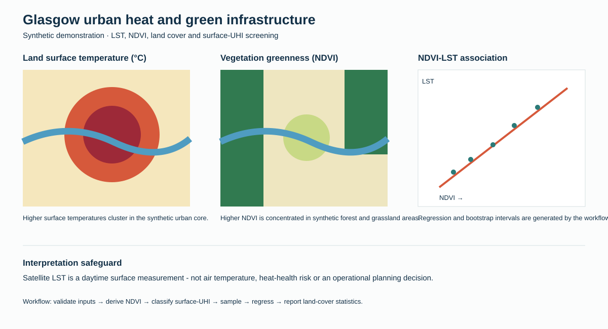

# Urban Heat Intervention Explorer

[](https://www.python.org/)
[](LICENSE)

A reusable, uncertainty-aware screening tool for identifying greener-infrastructure intervention opportunities from land-surface temperature (LST), NDVI and land-cover data.

## Try the interactive dashboard

**[Open the Urban Heat Intervention Explorer](https://7ao6688-hash.github.io/urban-heat-intervention-explorer/)** to explore NDVI uplift scenarios and screening cooling ranges in the browser. The live interface uses the synthetic demonstration scene; use the Python workflow below to analyse a custom city dataset.

> **Glasgow demonstration notice.** The repository ships a deterministic synthetic Glasgow-like raster scene as an example only. The tool is designed for any city with aligned LST, red/NIR and land-cover inputs.



## Why this project

Urban heat analysis is more defensible when it moves beyond a visually striking LST map. This project provides a transparent workflow for:

- NDVI derivation from red and near-infrared reflectance;
- pixel-level LST and land-cover quality checks;
- five-class surface-UHI screening from a documented statistical rule;
- stratified random sampling and an NDVI-LST regression with bootstrap confidence intervals;
- land-cover-specific LST summaries and a heat-exposure priority screen;
- an intervention screen that excludes water and already-green land, ranks hot built-up pixels, and reports NDVI uplift scenarios with bootstrap cooling ranges;
- a machine-readable report, SVG dashboard, tests and continuous integration.

## Demonstrated skills

`Landsat 8` · `LST` · `NDVI` · `urban heat island` · `land-cover analysis` · `Python` · `spatial sampling` · `regression` · `uncertainty communication` · `climate adaptation`

## Quick start

Python 3.10+ and NumPy are required.

```bash
python -m pip install -e .
urban-heat-explorer demo --output-dir output/demo
```

Or run without installation:

```bash
python scripts/run_demo.py
```

The demo creates a synthetic scene, `land_cover_statistics.csv`, `ndvi_lst_regression.json`, `uhi_area_statistics.csv`, `cooling_scenarios.json`, `intervention_priority.npz` and `summary.json`.

## Study context

The original coursework analysed Landsat 8 imagery acquired on 28 June 2019 for Glasgow. It estimated LST, derived NDVI, classified built-up, water, forest and grassland, and used 200 random samples to explore the NDVI-LST association. The public project is a rebuilt portfolio implementation, not a redistribution of coursework imagery or figures. Read the [Glasgow case-study note](docs/case-study.md) for the evidence boundary and the public extension.

## Input contract

`urban-heat-explorer analyse` accepts an `.npz` raster archive with aligned arrays:

| Array | Meaning | Expected values |
|---|---|---|
| `red` | surface reflectance, red band | non-negative |
| `nir` | surface reflectance, near infrared | non-negative |
| `lst_c` | land-surface temperature | degrees Celsius |
| `land_cover` | class identifier | 1 built-up, 2 water, 3 forest, 4 grassland |

```bash
urban-heat-explorer analyse data/my_city_scene.npz --output-dir output/my_run
```

See [the data guide](docs/data-guide.md) for a real-data preparation workflow using Landsat Collection 2, cloud masking and a documented LST method.

## Interpretation safeguards

Satellite LST is a daytime surface measurement, not air temperature, heat-health risk or a direct measure of social vulnerability. The intervention scenarios apply an observed NDVI-LST association for screening; they are not causal forecasts. Use the priority screen alongside demographic exposure, canopy quality, shade, building form, water access and local knowledge.

## Interactive dashboard

Open `dashboard/index.html` in a browser to explore the intervention-scenario interface. It is a lightweight product demonstration of the same screening logic; use the Python workflow for custom raster inputs and exportable outputs.

## Repository structure

```text
src/urban_heat_explorer/ analysis package and command-line interface
scripts/                reproducible demonstration and README preview builders
tests/                  deterministic unit tests
docs/                   case-study context, methods and data contract
```

## Licence

MIT. See [LICENSE](LICENSE).
