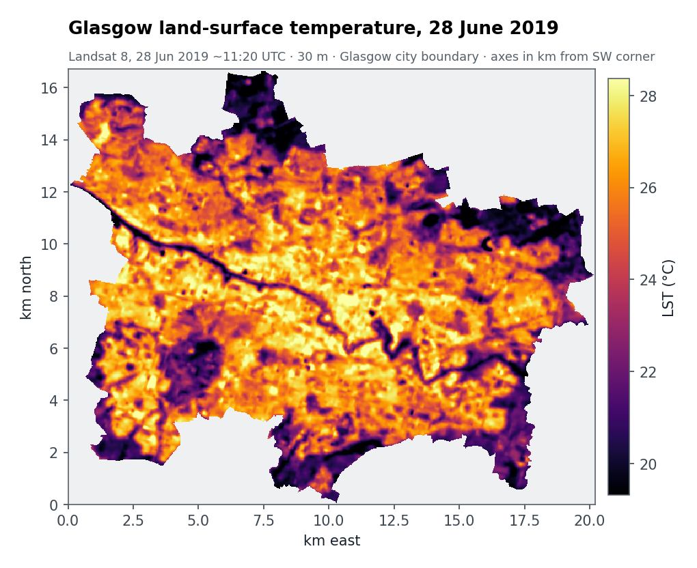
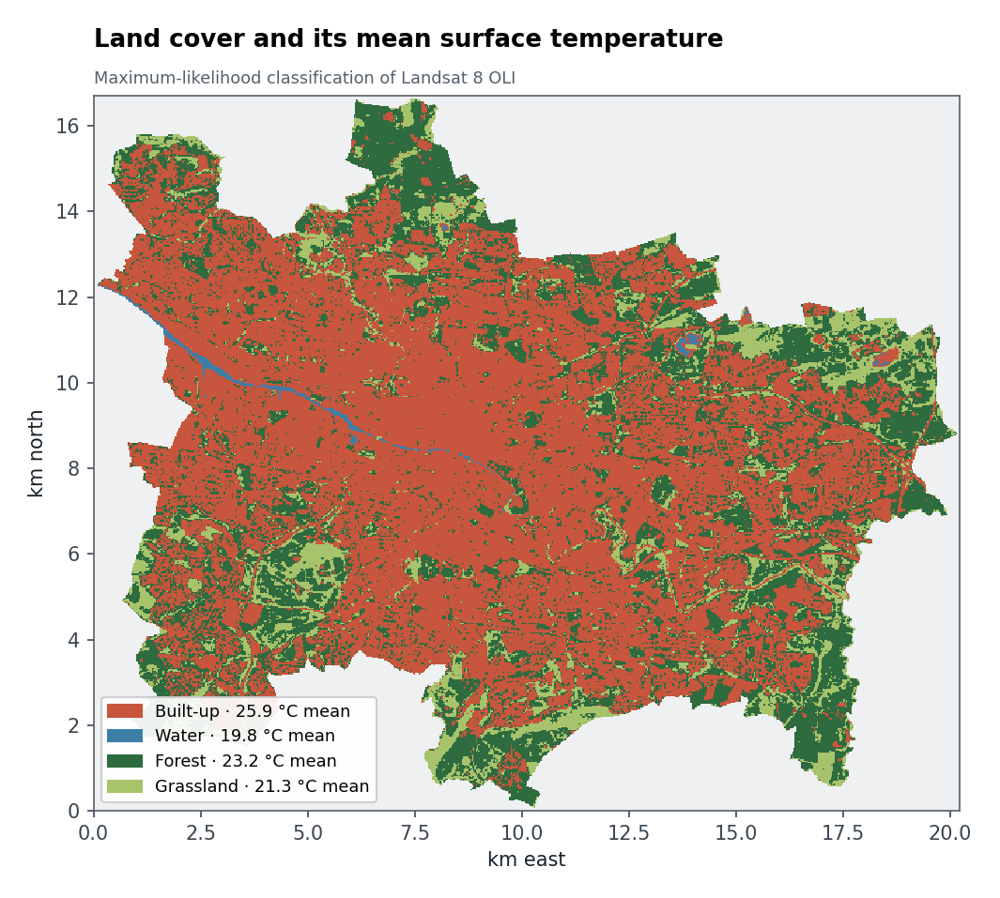
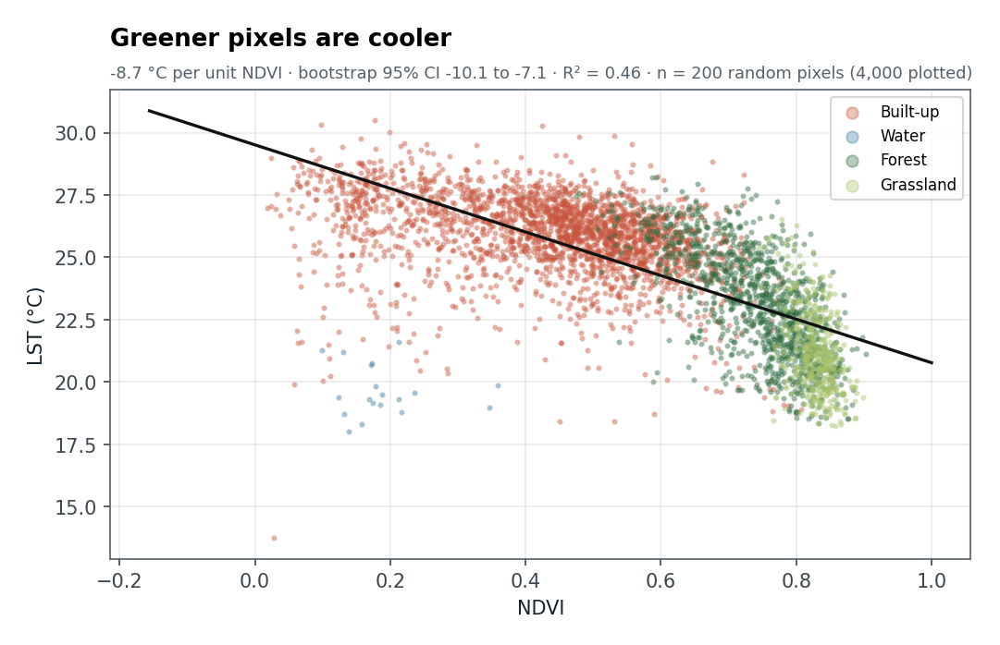
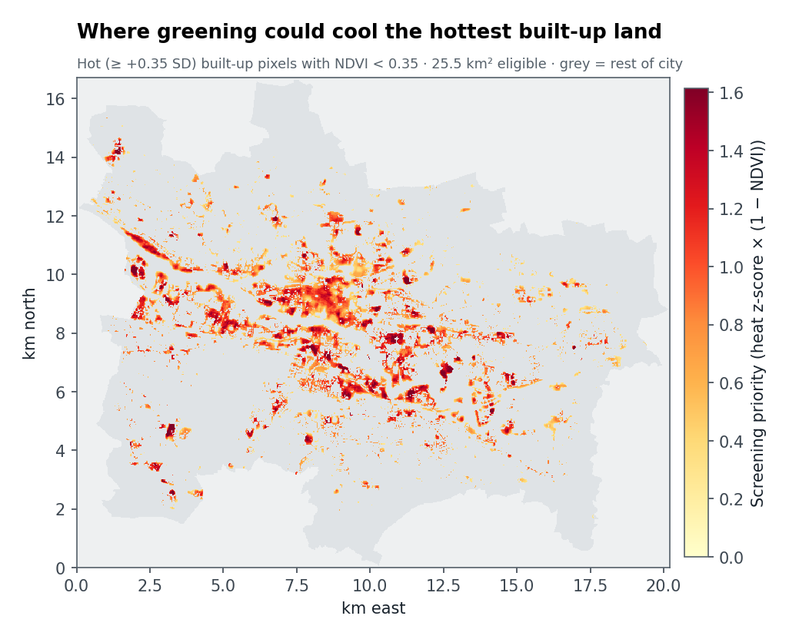

# Case study: Glasgow, 28 June 2019

**Observed Landsat 8 data · MSc coursework (University of Southampton, 2025), rebuilt as reproducible code**



## In plain terms

On a sunny June morning in 2019, Glasgow's built-up land was on average **4.6 °C hotter** at the surface than its grassland. Across the city, each 0.1 increase in vegetation greenness (NDVI) goes with a surface roughly **0.9 °C cooler**. About 25 km² of the hottest built-up land currently has little vegetation, which makes it the first place to look for street trees, green roofs or pocket parks.

## Data

| Item | Value |
|---|---|
| Scene | Landsat 8 Collection 2 Level-2, `LC08_L2SP_205021_20190628_20200827_02_T1` |
| Reflectance | SR_B4 (red) and SR_B5 (NIR), scaled ×0.0000275 − 0.2 |
| LST | TIRS band 10 single-channel retrieval in ENVI 5.6: TOA radiance → brightness temperature → NDVI-based emissivity → Sobrino correction |
| Land cover | Supervised maximum-likelihood classification: built-up, water, forest, grassland |
| Study area | Glasgow city boundary, 225,280 valid 30 m pixels (≈ 203 km²) |

Landsat data are public domain (USGS). The aligned, boundary-clipped scene is committed as [`results/glasgow_scene.npz`](results/glasgow_scene.npz), so you can rerun the analysis without downloading anything.

## Results

| Land cover | Area (km²) | Mean LST (°C) | 95th percentile LST (°C) | Mean NDVI |
|---|---:|---:|---:|---:|
| Built-up | 121.3 | 25.9 | 28.1 | 0.44 |
| Forest | 59.1 | 23.2 | 26.7 | 0.74 |
| Grassland | 21.4 | 21.3 | 24.5 | 0.83 |
| Water | 0.9 | 19.8 | 21.8 | 0.21 |

City mean LST is 24.6 °C (SD 2.5 °C). Pixels ≥ 1 SD above the mean, the surface heat-island core, cover 14.2% of the city (28.8 km²).





The regression uses the same 200-pixel random sample design as the coursework, with a bootstrap confidence interval on the slope: −8.7 °C per unit NDVI (95% CI −10.1 to −7.1, R² = 0.46).



| NDVI uplift on eligible land | Screening cooling | Bootstrap range |
|---|---:|---:|
| +0.05 | 0.44 °C | 0.35 – 0.51 °C |
| +0.10 | 0.87 °C | 0.71 – 1.01 °C |
| +0.15 | 1.31 °C | 1.06 – 1.52 °C |

Eligible land is built-up pixels at least 0.35 SD hotter than the city mean with NDVI below 0.35: 25.5 km² in total.

## Reproduce

From the committed scene:

```bash
python -m urban_heat_explorer analyse case-studies/glasgow-2019/results/glasgow_scene.npz --output-dir output/glasgow
```

From the raw inputs, including the figures:

```bash
pip install -r case-studies/requirements.txt
python case-studies/glasgow-2019/build_case.py \
    --landsat-prefix path/to/LC08_L2SP_205021_20190628_20200827_02_T1_ \
    --lst path/to/LST_full.tif --classification path/to/classification.tif \
    --boundary path/to/Glasgow_Boundary.shp
```

## Limits of this result

- **Satellite LST is a surface temperature** at about 11:20 UTC on one clear day, not air temperature or heat-health risk.
- **The cooling figures are associations.** They extrapolate the city-wide NDVI–LST slope and aren't a causal forecast for any one site.
- **Water is under-mapped** (0.9 km²). At 30 m, the narrow Clyde mixes with its banks and is partly classed as built-up.
- **No accuracy assessment** has been done for the land-cover classification.
- The coursework's land-cover area table summed to 88.8 km², which can't be reproduced from the saved rasters. The figures here are recomputed over every valid pixel inside the city boundary.
